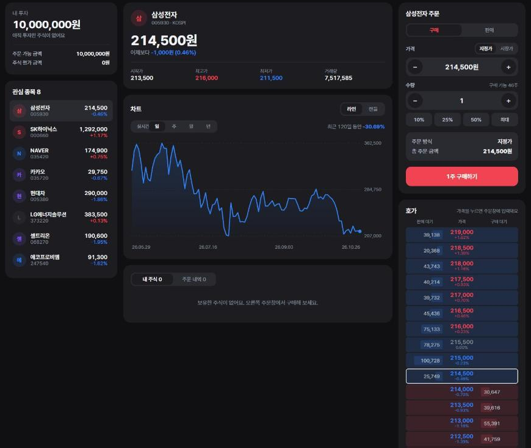
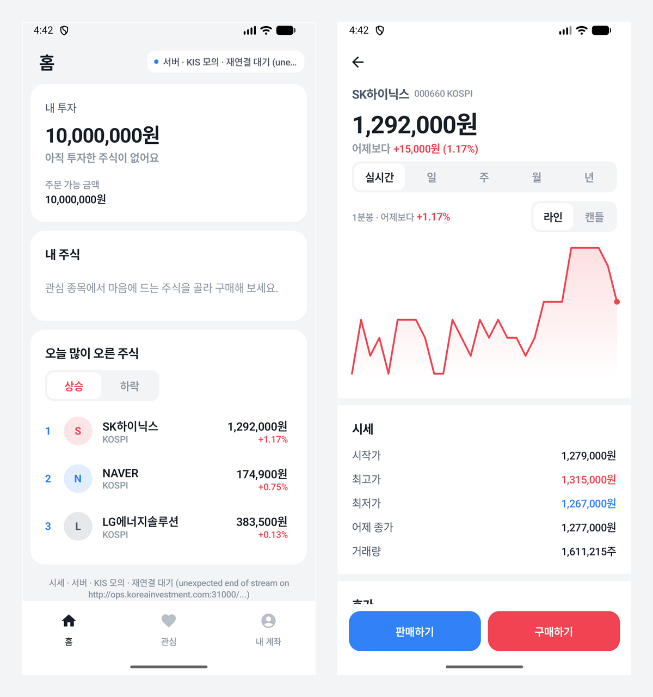
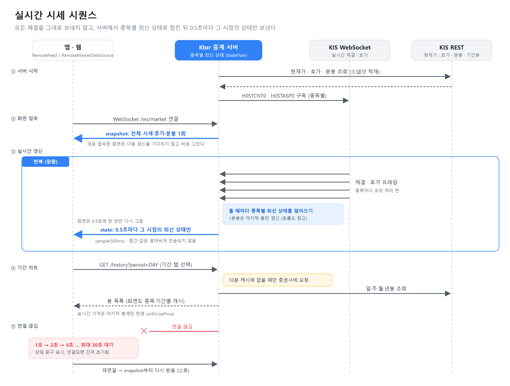
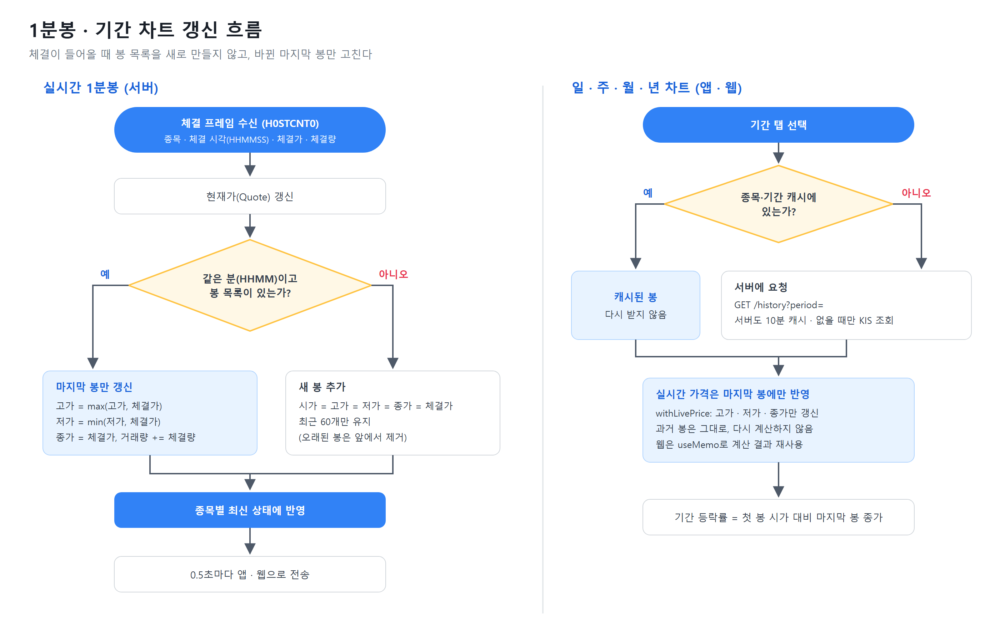
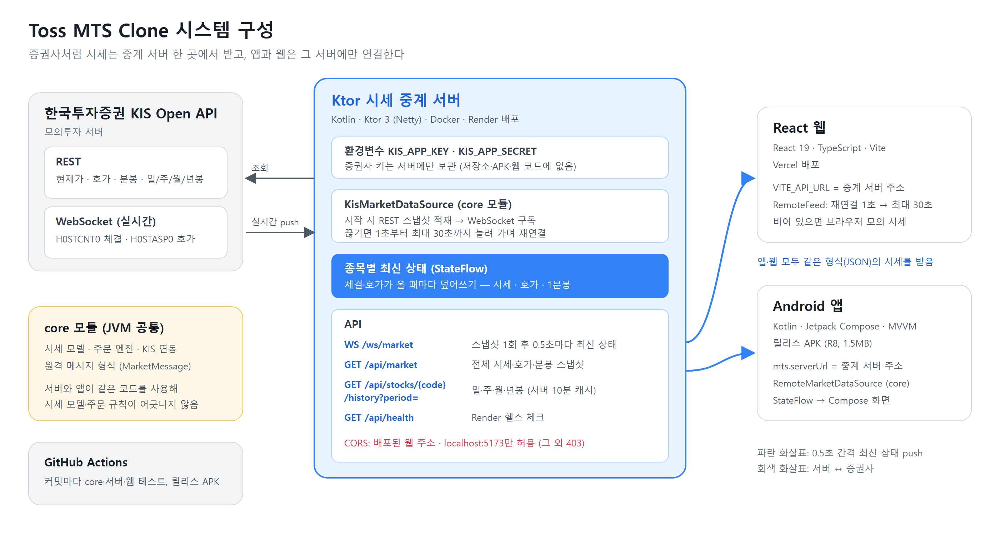

# Toss MTS Clone

한국투자증권 Open API(모의투자)의 실시간 시세를 **Android 앱(Kotlin·Jetpack Compose)** 과 **PC 웹(React)** 에 같은 형식으로 보여 주는 토스증권 스타일 모의투자 MTS입니다.
증권사처럼 시세는 **Kotlin(Ktor) 중계 서버** 한 곳에서 받고, 앱과 웹은 그 서버에만 연결합니다.

> 개인 학습용 프로젝트이며 토스증권(비바리퍼블리카)과 관계가 없습니다. 주문은 앱 안의 모의 계좌에서만 체결됩니다.

| 웹 | Android 앱 | 중계 서버 |
|---|---|---|
| [toss-mts-clone.vercel.app](https://toss-mts-clone.vercel.app) | [APK 내려받기 (v0.1.0)](https://github.com/Song-ki-beom/toss-mts-clone/releases/tag/v0.1.0) | [상태 확인](https://mts-relay.onrender.com/api/health) |

무료 서버라 한동안 접속이 없었다면 첫 연결에 최대 1분 정도 걸립니다.

## 주요 성과
- **앱·웹·중계 서버를 혼자 설계부터 배포까지** 진행했습니다 (2026.10.24 ~ 10.26, 기능 단위 커밋).
- **체결마다 다시 그리지 않는 실시간 시세**: 초당 여러 번 들어오는 체결·호가를 종목별 최신 상태로 합쳐 0.5초마다 한 번만 보냅니다.
- **표시 오류의 원인을 원본 데이터로 확정**: 호가 단위에 맞지 않는 체결가(예: 215,250원)를 원본 프레임 로그로 추적해, 모의 서버가 1호가 중간값을 보내는 것이 원인임을 확인하고 모의투자 모드에서만 보정했습니다.
- **증권사 키는 서버에만**: 키는 서버 환경변수에만 두고, 저장소·APK·웹 코드에는 넣지 않았습니다.
- **릴리스 APK 12.4MB → 1.5MB** (R8 축소·리소스 정리)
- **테스트 61개** (core 23 · 서버 5 · 웹 33), 커밋마다 GitHub Actions에서 실행. 서버 테스트에는 실제 서버를 띄워 앱용 클라이언트로 접속하는 종단 간 테스트가 포함됩니다.

## 성능 처리
| 구분 | 단순하게 구현하면 | 적용한 방식 |
|---|---|---|
| 화면 갱신 | 체결이 들어올 때마다 다시 그림 | 서버가 최신 상태로 합쳐 0.5초에 한 번 전송 |
| 새 접속 | 다음 갱신까지 빈 화면 | 접속 직후 전체 스냅샷 1회 |
| 1분봉 | 체결마다 봉 목록을 새로 만듦 | 같은 분이면 마지막 봉의 고가·저가·종가·거래량만 수정 |
| 기간 차트 | 가격이 움직이면 봉을 다시 받거나 계산 | 받은 봉 캐시(서버 10분), 실시간 가격은 마지막 봉에만 반영 |
| 연결 끊김 | 화면이 마지막 값에 멈춤 | 1초부터 최대 30초까지 간격을 늘려 자동 재연결, 상태 표시 |

## 구조

| 모듈 | 내용 |
|---|---|
| `core/` | 시세 모델, 모의 주문 엔진, KIS 연동, 원격 메시지 형식. 앱과 서버가 함께 쓰는 JVM 모듈 |
| `server/` | Ktor 중계 서버: `GET /api/market`, `GET /api/stocks/{code}/history`, `WS /ws/market` |
| `app/` | Android 앱 (Jetpack Compose, MVVM, StateFlow) |
| `web/` | PC 웹 트레이딩 화면 (React 19, TypeScript, Vite) |

## 기술 스택
| 영역 | 기술 |
|---|---|
| 앱 | Kotlin, Jetpack Compose, Coroutines·StateFlow, OkHttp, kotlinx.serialization |
| 웹 | React 19, TypeScript, Vite, Vitest |
| 서버 | Kotlin, Ktor 3 (Netty, WebSocket), Docker |
| 외부 API | 한국투자증권 KIS Open API (REST, WebSocket 실시간 체결·호가) |
| 배포·CI | GitHub Actions (테스트, 서명된 APK·AAB 릴리스), Vercel, Render |
